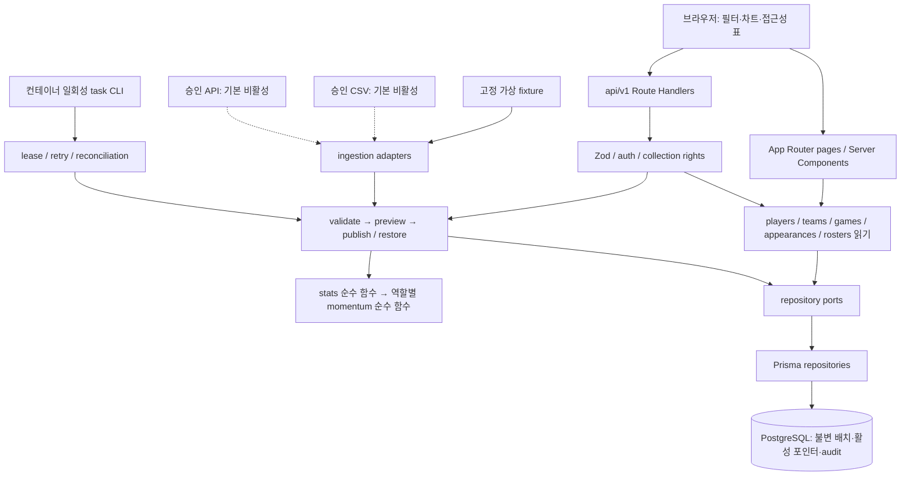
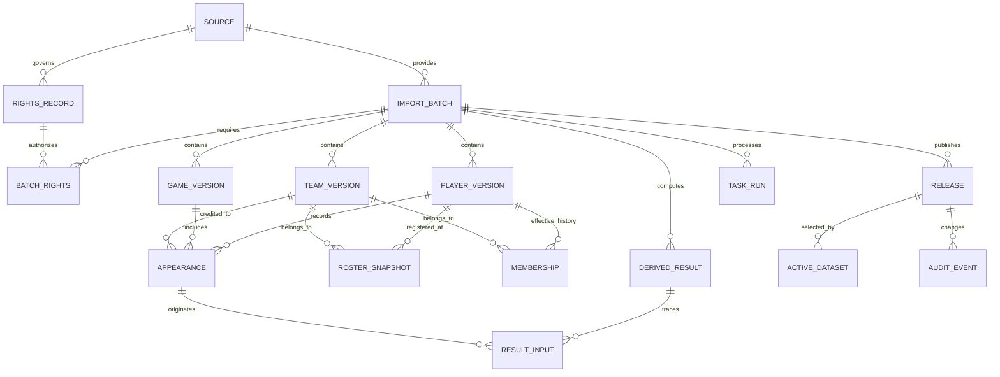

# DUGOUT PULSE 단일 저장소 아키텍처

- 결정일·확인일: 2026-11-03 (Asia/Seoul).
- 상태: **아키텍처 채택 / 구현·설치·호환성 검증 미완료**. [ADR-008](DECISIONS.md#adr-008-단일-앱과-postgresql-컨테이너-아키텍처)을 적용한다.
- 기준: [PRD](PRD.md), [실행 규칙](../AGENTS.md), [데이터 권리](DATA_RIGHTS.md), [출시 게이트](RELEASE_GATES.md). P0 문서 작업이며 P1~P5 완료나 배포 승인이 아니다.

## 1. 결정과 기술 선택

**단일 pnpm 패키지의 Next.js App Router 앱을 Node 컨테이너로 실행하고 PostgreSQL + Prisma를 영속 저장 경계로 사용한다.** 별도 API 서버·마이크로서비스·워크스페이스 빌드 도구는 두지 않는다. 공개 읽기는 Server Components에서 읽기 서비스를 직접 호출하고 브라우저 요청만 Route Handlers를 통한다. 자체 HTTP 호출로 서버 간 왕복을 만들지 않는다.

| 선택 | 이유 | 검토 대안·비용 |
| --- | --- | --- |
| Next.js App Router + React, TypeScript strict | 공개 서버 렌더링과 관리자 서버 경계를 한 앱에서 관리 | Vite SPA + 별도 API는 배포·계약 중복 증가. Next의 캐시·서버/클라이언트 경계는 명시적으로 관리 |
| Tailwind CSS + shadcn/ui 방식의 Radix 기반 소스 컴포넌트 | 필요한 컴포넌트만 소유·수정하고 한국어·키보드 UX 조정 | 대형 UI 키트보다 선택 범위가 작음. 생성 코드도 접근성·라이선스 검수 필요 |
| Recharts | React 연동과 제한된 경기 추이 표현 | ECharts는 기능 대비 초기 번들·설정 부담. 표만으로 시작 가능하나 PRD 그래프는 생략 불가 |
| PostgreSQL + Prisma ORM | 원자 게시, 참조 무결성, 감사·복구, 명시적 마이그레이션 | fixture 파일은 입력·테스트용으로 유지. SQLite는 실제 PostgreSQL 동시성·검색 검증을 대체하지 않음 |
| Zod | 입력·쿼리·환경·공개 DTO를 런타임 검증 | TS 타입만으로 외부 입력을 보장할 수 없음. DB 제약과 교차 행 검증은 별도로 필요 |
| Vitest + Playwright | 순수 계산과 실제 DB 통합, 브라우저 흐름을 분리 검증 | 브라우저 테스트만으로 수치 경계 검증 시 느리고 진단 어려움 |
| Node 컨테이너 + PostgreSQL 컨테이너 기본 배포 | 같은 이미지로 로컬/배포 실행, 공급자 전용 런타임 의존 최소화 | Vercel Node는 대안. 파일 영속성·작업 제한·DB 연결 풀·캐시를 재검토해야 함 |

초기 컨테이너 구성은 웹 앱과 PostgreSQL 두 역할이며 DB는 인프라이지 별도 도메인 서비스가 아니다. 유료 서비스·계정 생성은 요구하지 않는다. P1은 앱 기반, P2는 스키마·fixture와 DB 계약, P4는 관리자 게시 흐름을 구현한다. DB 채택은 이전의 “fixture 우선·DB 미정”을 구체화하며 P0에 DB를 실행한다는 뜻은 아니다.

### 실제 버전 확인과 고정 정책

현재 프로젝트에 `package.json`, lockfile, `node_modules`, 앱·검사 스크립트는 없다. 로컬 `node --version` = `v26.11.0`, `pnpm --version` = `12.10.1`. 설치된 앱 패키지 버전으로 아래 표를 해석하지 않는다.

2026-11-03 공식 [npm 레지스트리](https://registry.npmjs.org/) JSON을 Node 기본 TLS 검증의 `fetch`로 읽었다. `/패키지명/latest`의 `version`, `engines`, `peerDependencies`를 조회했고 Prisma는 전체 메타데이터의 안정 semver와 dist-tags도 대조했다. 패키지 다운로드·설치는 하지 않았다. Python 조회는 sandbox DNS, 이후 인증서 체인 오류로 실패했으며 Node 조회는 성공했다. TLS 검증은 끄지 않았다.

| 패키지/런타임 | 선택 버전 | 조회 근거·주의 |
| --- | --- | --- |
| Node.js / pnpm | 26.11.0 / 12.10.1 | 로컬 실행 확인. Node 26은 [공식 LTS 목록](https://nodejs.org/en/about/previous-releases)에 있음 |
| next | 16.4.4 | [메타데이터](https://registry.npmjs.org/next/latest), Node >=20.9 |
| react / react-dom / react-is | 19.3.1 (동일) | [React](https://registry.npmjs.org/react/latest), [DOM](https://registry.npmjs.org/react-dom/latest), [react-is](https://registry.npmjs.org/react-is/latest). react-is는 Recharts peer |
| typescript | 7.0.2 | [메타데이터](https://registry.npmjs.org/typescript/latest). strict 필수, 실제 Next 타입 생성·빌드 호환성은 P1 검증 |
| tailwindcss / @tailwindcss/postcss | 4.3.4 (동일) | [CSS](https://registry.npmjs.org/tailwindcss/latest), [PostCSS](https://registry.npmjs.org/@tailwindcss%2Fpostcss/latest) |
| radix-ui / shadcn CLI | 1.8.1 / 4.23.0 | [Radix](https://registry.npmjs.org/radix-ui/latest), [CLI](https://registry.npmjs.org/shadcn/latest). shadcn은 UI 런타임 버전이 아닌 코드 생성 도구; 생성 소스·추가 의존성 별도 고정 |
| recharts | 3.10.1 | [메타데이터](https://registry.npmjs.org/recharts/latest), React/DOM/react-is 19 범위 허용 |
| prisma / @prisma/client / @prisma/adapter-pg | 7.10.1 (동일) | [CLI 전체 메타데이터](https://registry.npmjs.org/prisma), [Client](https://registry.npmjs.org/@prisma%2Fclient/latest), [adapter](https://registry.npmjs.org/@prisma%2Fadapter-pg/latest). CLI latest=8.0.0-rc.29는 제외; 안정 7.10.1 확인 |
| pg | 8.23.1 | [메타데이터](https://registry.npmjs.org/pg/latest), Node >=16 |
| zod | 4.6.7 | [메타데이터](https://registry.npmjs.org/zod/latest) |
| vitest | 5.1.0 | [메타데이터](https://registry.npmjs.org/vitest/latest), Node >=26 범위 포함 |
| @playwright/test | 1.64.1 | [메타데이터](https://registry.npmjs.org/@playwright%2Ftest/latest), Node >=20 |
| PostgreSQL | 18.6 | [공식 지원 표](https://www.postgresql.org/support/versioning/)의 지원 안정 버전. 설치/컨테이너 pull 미실행 |

위 값은 선택 기준이지 검증된 전체 dependency graph가 아니다. P1에서 승인된 설치 단계에 정확한 버전과 `packageManager`, Node 버전을 고정하고 lockfile을 생성한다. 필요한 타입 패키지·ESLint·PostCSS·Vite 등 전이/개발 의존성도 실제 메타데이터를 확인한다. prerelease는 제외하고 peer 충돌·빌드 실패·보안 공지가 있으면 안정 호환 조합으로 ADR을 갱신한다. `latest` 태그를 그대로 설치하지 않는다. 컨테이너 이미지는 실행 단계에 digest까지 기록한다. Prisma 7의 설정·생성 클라이언트·pg adapter는 해당 버전 문서를 기준으로 구현하며 구버전 설정을 추측하지 않는다.

## 2. 폴더 책임과 의존 방향

다음은 **구현할 목표 구조**이며 현재 존재하는 코드가 아니다. 단일 `package.json`·lockfile로 관리한다.

| 경로 | 책임·의존 가능 대상 |
| --- | --- |
| `src/app/(public)/` | PRD의 `/`, `/players`, `/players/[id]`, `/rankings`, `/compare`, `/about`; 서버 페이지는 read services, UI에 의존 |
| `src/app/admin/` | 인증된 관리자 화면. 서버 auth와 import use cases 호출; middleware만 믿지 않음 |
| `src/app/api/v1/` | HTTP 파싱·Zod·인증·응답 매핑만 수행; 계산/SQL/게시 트랜잭션 구현 금지 |
| `src/components/ui/` | 소유한 접근성 기본 컴포넌트; 도메인/DB 의존 없음 |
| `src/components/features/` | 선수 카드·표·필터·차트. 공개 DTO와 UI 사용; 클라이언트 컴포넌트는 서버 모듈 import 금지 |
| `src/contracts/` | 버전 입력 스키마·공개 DTO·오류 코드·쿼리 검증; Zod만 사용하는 공유 계약, Prisma 타입 노출 금지 |
| `src/domain/stats/` | 타격/투구 집계·비율·구간 순수 함수; domain 타입만 의존 |
| `src/domain/momentum/` | batter/starter/reliever 모델과 설명·상태; stats/domain만 의존 |
| `src/domain/` | ID·시즌·대회·날짜·provenance·상태 타입/불변식; Next/DB/I/O 의존 없음 |
| `src/server/reads/` | players, teams, games, appearances, rosters 읽기 서비스; 공통 scope와 저장소 포트로 공개 DTO 구성 |
| `src/server/imports/` | validate/preview/publish/restore/reprocess 유스케이스; 권리·권한·adapter·순수 계산·저장소 포트 조합 |
| `src/server/ports/` | 읽기·배치·트랜잭션 저장소, 입력 adapter 인터페이스; 필요한 경계만 정의 |
| `src/server/ingestion/` | mock-fixture, authorized-csv, authorized-api adapter. 외부 형식을 버전 입력 계약으로 변환; 게시·공개 DB 직접 쓰기 금지 |
| `src/server/repositories/` | Prisma 구현·검색 쿼리·원자 트랜잭션; domain과 ports에 의존 |
| `src/server/auth/`, `rights/` | 세션·역할·CSRF, 소스별 수집/저장/가공/공개 권리 검사. 미설정은 거부 |
| `src/server/db/`, `observability/` | Prisma/pg 연결 수명·설정, 구조화 로그·측정; server-only |
| `src/server/tasks/` | 작업 lease·재시도·권리 만료 점검·재계산; imports의 같은 유스케이스 호출 |
| `src/server/composition.ts` | 실제 adapter/repository 의존성 조립. 테스트는 동일 ports에 대역 주입 |
| `prisma/` | 버전 스키마·SQL migration·개발용 seed; 승인된 가상 fixture만 seed |
| `fixtures/` | 버전/제작 이력/해시가 있는 가상 정상·오류 입력. 외부 네트워크 불필요 |
| `tests/unit/`, `tests/integration/`, `tests/e2e/` | 순수 함수, 실제 PostgreSQL, Playwright 검증 |
| `scripts/`, `docs/` | task CLI·검증 진입점, ADR·계약·운영 문서; 비밀 값 없음 |

의존은 UI/HTTP → use case → domain·ports, infrastructure → ports/domain 방향이다. composition만 구체 구현을 안다. domain → server/app, UI → repository, adapter → publish 직접 참조는 금지한다. P1에서 ESLint restricted imports와 `server-only` 경계로 검사하고 TypeScript `strict`를 활성화한다. 공유 거대 `utils`나 범용 repository 프레임워크는 만들지 않는다.

## 3. 스키마의 큰 경계

정확한 필드·enum·키는 P2의 버전 스키마와 migration에서 확정한다. 아래는 채택한 무결성·집계 경계다.

- `Source/RightsRecord`: sourceId와 권리 버전·효력·만료·철회·collection/storage/derivation/publication 허용 필드·시즌·대회·안전한 증빙 참조를 저장한다. 내부 증빙과 공개 출처 DTO는 분리한다. 권리 변경은 이전 버전과 감사 기록을 보존한다.
- `ImportBatch`: schemaVersion, batchId, sourceId, rightsRecord 참조, mode, season, competition, asOf, importedAt, 파일 해시, 정규화 해시, adapterVersion, 상태·검증 보고서 참조. **배치는 한 시즌·대회·DEMO 모드의 완전 스냅샷**이다. 증분 입력은 staging에서 기존 승인 데이터와 합쳐 새 완전 배치로 만들고 다시 검증한다. 서로 다른 실제/가상 입력은 거부한다.
- 선수·팀은 안정 논리 ID와 `(batchId, entityId)` 버전을 구분한다. 경기·등록·소속·출전의 FK는 같은 batchId까지 묶어 교차 배치 참조를 막는다. 소속은 효력일 범위, 등록은 snapshot 기준일·effectiveDate·registered/unregistered/unknown을 별도로 가진다.
- 경기 키는 원천 경기 ID를 사용해 더블헤더를 구분한다. 일정·취소·미완료·종료·정정 상태를 보존하고 종료·유효 기록만 집계한다. 출전 unique 키는 batch/player/game/role/원천 line ID로 명시하며 한 경기의 타격과 투구를 허용한다. 중복 분할 행을 어떻게 합칠지는 P2 입력 계약으로 고정한다.
- 타격·투구 원천 카운트는 구분하고 투구는 정수 아웃 수를 쓴다. 음수·잘못된 분모·안타 구성 모순·알 수 없는 참조·시즌/대회 불일치·범위 밖 날짜는 거부한다. null·0·미출전은 다르다. DB CHECK/UNIQUE/FK와 Zod·교차 행 검증을 함께 적용한다.
- `DerivedResult`: 계산 버전·modelVersion·입력 해시·batch·player·teamScope·role·season/competition·기준일·window·표본 단위/실제/최소·원시 결과·기여 요인·status를 갖는다. `ResultInput`으로 모든 입력 행과 source/batch/rights를 추적한다. 다중 출처의 as-of는 출처별 보존하고 요약 기준일을 명시한다.
- `Release/ActiveDataset`: 시즌·대회·mode별 활성 release 포인터와 단조 증가 revision. release는 batch + 계산 실행 버전의 완전 묶음이다. 복구도 기존 행 수정 대신 새 release 이력을 생성한다. 모델 버전이 다른 결과는 한 release에 섞지 않는다.
- `AuditEvent`: 내부 actor ID, action, 대상 batch/release, 성공/실패, 시각, requestId. 공개 API·원본·세션·비밀번호·민감 증빙은 포함하지 않는다. 앱 DB 역할은 audit UPDATE/DELETE 불가; migration 역할 분리. 법적 보관/파기 정책은 P5 확정.

통계는 합산 분자/분모로 계산하고 표시 직전 반올림한다. 타자·선발·구원 기록을 분리하고 팀 필터는 해당 팀 경기만, 전체 팀은 시즌 합계로 계산한다. 모델은 P3까지 미확정이며 현재 점수 생성 금지. 미래 데이터 비참조, 직전 비중첩 구간, 원값 동점 1·1·3 및 안정 ID 정렬을 테스트한다.

## 4. API와 공개 계약

서버 페이지와 Route Handler는 같은 읽기 서비스를 사용한다. `v1`은 외부 DTO 버전이며 DB 스키마 버전과 독립이다. 다음 경로는 설계 계약안이고 실행 가능한 API는 아직 없다.

| 경계 | 메서드·경로 | 책임 |
| --- | --- | --- |
| 공개 읽기 | GET `/api/v1/players`, `/players/:id`, `/teams`, `/games`, `/appearances`, `/rosters` | 허용 필드·출처·표본을 포함한 조회. 선수 목록 기본 이름순 20명 cursor 페이지 |
| 가공 읽기 | GET `/api/v1/rankings`, `/compare`, `/sources` | 역할·모델·scope 일치, 비교 최대 2명; sources는 안전한 공개 필드만 |
| 관리 입력/검증 | POST `/api/v1/admin/imports`, `/imports/:id/validate` | 파일 제한·형식·참조·권리 검증, staging 격리 |
| 관리 미리보기 | GET `/api/v1/admin/imports/:id/preview` | 공개와 같은 projector로 차이·영향·메타데이터 검수; 게시 전 공개 URL 없음 |
| 관리 게시/복구 | POST `/api/v1/admin/imports/:id/publish`, `/releases/:id/restore` | Idempotency-Key + expectedRevision, 서버 권한·권리 재검사, 원자 교체 |
| 관리 감사/재처리 | GET `/api/v1/admin/imports`, `/audit`; POST `/imports/:id/reprocess` | 접근 제한 목록·감사 및 버전 지정 재계산; 재계산 완료가 자동 게시는 아님 |

공통 scope는 season, competition(`regular`/`postseason`), role(`batter`/`starter`/`reliever`), teamId, 데이터 기준일, releaseId다. 공개 응답은 `data`와 `meta`(schemaVersion, release/revision, mode, 출처별 asOf, importedAt, 계산 버전, 표본·기간·상태)를 가진다. 내부 DB 객체를 그대로 JSON으로 반환하지 않는다. 미공개 선수·배치의 존재를 공개 endpoint로 노출하지 않는다.

첫 요청이 활성 release를 고정하고 cursor·후속 상세/비교 링크도 그 release를 전달해 페이지 사이 배치 혼합을 방지한다. 삭제/권리 철회된 release는 재사용할 수 없고 최신 조건 재선택을 안내한다. cursor는 release·필터 hash·마지막 이름/ID를 포함하며 검증한다. 최대 limit=20, 검색어 길이 최대 100자, 비교 2명 제한을 서버에서 적용하는 설계 기본값으로 둔다.

화면의 잘못된 URL 조건은 안전한 기본값과 사유 안내로 정규화한다. API의 잘못된 입력은 400/422, 미인증 401, 권한 거부 403, 없는 공개 ID 404, 동시 변경 409, 용량 초과 413, 일시 DB 실패 503으로 매핑한다. 오류 DTO는 code/message/requestId/안전한 fieldErrors만 반환하고 SQL·stack·원본 파일을 숨긴다. `loading.tsx`, `error.tsx`, `not-found.tsx`와 기능별 빈 상태·부분 비교 오류·오프라인 재시도를 설계한다. 오프라인 쓰기 큐는 없다.

## 5. 수입·게시·재처리와 권한

1. 서버에서 인증·관리 역할과 **collection(수집) 권한**을 검사한다. source별 collection/storage/derivation/publication 권한은 독립이며 관리자 역할만으로 소스 승인을 대신하지 못한다. 현재 fixture adapter만 활성, CSV/API는 등록·호출 기본 거부다. CSV 파일 보유도 권리 근거가 아니다.
2. 입력은 stream 제한(제안: 5 MiB·50,000행)과 MIME/UTF-8·구문 검증을 적용해 비공개 staging에 저장한다. 제한은 P2 부하·오류 테스트 후 확정한다. API adapter는 승인 호스트 allowlist, timeout·응답 크기·재시도 한도를 갖고 사용자 URL을 직접 fetch하지 않는다.
3. adapter가 공통 입력 계약으로 정규화하고 Zod·참조·권리·출처·시각·공개 필드를 검증한다. `received → validating → validated / rejected → ready → published` 상태 전이는 서버에서 제한한다. preview와 게시 대상 해시를 고정하고 변경 시 재검증한다.
4. 비공개 immutable staging에서 stats·기세를 계산한다. P3 미확정 모델은 `model_unconfirmed`로 처리하며 점수·순위를 만들지 않는다. preview는 행/필드/원인과 공개 diff를 보여주되 원본·증빙 비밀은 노출하지 않는다.
5. publish는 DB 트랜잭션에서 대상 scope의 활성 행을 잠그고 expectedRevision·권리 유효성·검증 해시·계산 완결성을 재검사한다. 최초 scope 생성도 UNIQUE 제약으로 직렬화한다. release 생성·포인터 교체·audit 성공·idempotency 결과 저장을 한 번에 커밋한다. 충돌 시 409이며 자동 덮어쓰지 않는다. 실패 시 기존 공개 배치는 유지한다.
6. 복구도 현재 권리·모드·계산 버전을 재검증하고 같은 원자 교체 경로를 쓴다. 만료된 실제 배치로는 복구하지 않는다. 실패 audit은 롤백 후 별도 트랜잭션으로 남기며 DB 전체 장애 시 requestId 로그로 복구 후 대조한다.

Idempotency는 `(actorId, action, scope, key)` UNIQUE와 요청 payload hash로 관리한다. 같은 key·같은 payload는 저장한 결과를 반환하고 다른 payload는 409다. 파일 중복은 `(sourceId, mode, season, competition, schemaVersion, canonicalHash)`로 식별한다. 해시만으로 승인·권한 검사를 생략하지 않는다. 재계산 키는 batch hash + 계산/model 버전 + scope + 기준일이며 입력은 보존하고 새 실행 결과를 추가한다. parser/schema 변경은 명시적 변환 버전·migration과 이전 fixture 회귀 테스트를 동반한다.

관리자 인증은 P1에 검증할 **DB 서버 세션 + 초대된 관리자만**을 기본안으로 둔다. 공개 회원가입 없음, 검증된 인증 라이브러리의 자격증명/세션 기능과 Node 지원 비밀번호 해시를 선택·버전 검증하기 전에는 관리자 전체를 기본 거부한다. 직접 암호 알고리즘을 구현하지 않는다. Secure/HttpOnly/SameSite 쿠키, 세션 만료·폐기·로그인 속도 제한, 모든 관리자 조회/쓰기의 역할 재검사, 상태 변경의 POST·Origin/CSRF 토큰 검사를 필수로 한다. 초기 관리자 provisioning은 배포 시 비공개 CLI이며 실제 자격증명을 저장소에 넣지 않는다. 인증 패키지·운영 계정·보관 기간은 미결정으로 [ASSUMPTIONS](ASSUMPTIONS.md)에 남긴다.

## 6. 비기능 설계

| 항목 | 결정·실패 시 동작 |
| --- | --- |
| 시간/KST | 순간은 UTC `timestamptz`, 경기일·기준일은 명시적 KST calendar date. 입력 timestamp는 offset 필수, naive 시각 거부. 표시는 `Asia/Seoul`. 휴식·7/14일 윈도는 데이터 기준일의 KST 날짜 차이로 계산하며 `Date.now()`를 순수 함수에서 읽지 않음 |
| 시즌·대회 | 모든 조회·키·캐시·계산에 scope 포함. 기본은 fixture에 있는 최신 시즌·정규시즌. 시즌을 timestamp의 연도에서 추측하지 않음. 등록 scope와 출전 scope는 분리 |
| 상태·신뢰도 | `ok`, `insufficient_sample`, `missing_data`, `no_appearance`, `model_unconfirmed`와 stale/update_failed 구분. 실제/최소 표본·단위·마지막 출전일·결측 이유를 제공. 임의 신뢰 확률 생성 금지; 신뢰도는 표본 충족/결측/출처 상태로 설명 |
| 출처·권리 | 요청마다 현재 rights를 확인한 후 release 읽기. 철회/만료 시 마지막 실제 배치도 차단하고 승인된 DEMO 또는 빈 상태. 권리 철회는 역사 batch에 연결된 권리에도 적용. 원본·파생물·캐시·백업 삭제 의무를 task로 추적 |
| 검색 인덱스 | NFC 정규화 이름 + 안정 ID, batch 내 B-tree 이름 prefix 검색, bound query 사용. `(batchId, season, competition, role, teamId, playerId, gameDate)` 등 실제 조회에 맞춘 복합 인덱스. 한국어 부분 검색은 초기 규모에서 제한된 ILIKE; EXPLAIN 확인 후 pg_trgm GIN 검토. 외부 검색 엔진 없음 |
| 캐시 무효화 | MVP 데이터 응답은 `private, no-store`/동적 렌더링, CDN/Next 영속 데이터 캐시 비활성. 요청 내 중복 읽기만 메모화. SQL의 활성 포인터가 즉시 기준이므로 여러 replica 간 로컬 캐시 불일치 없음. 정적 소개의 데이터 출처 영역도 동적 조회 |
| 캐시 확대 조건 | 측정된 병목 때 immutable releaseId+모델+필터 캐시 도입. 활성 포인터·rights는 캐시하지 않음. 이전 release 캐시도 권리 검사 후만 사용; 정적 페이지/공유 이미지/브라우저 저장까지 철회 정책에 포함. 게시 invalidation 실패 시 stale 공개를 허용하지 않는 설계부터 검증 |
| 오류·관측 | requestId/batchId/taskId, latency·조회 실패·거부·게시 충돌·작업 지연·asOf 나이의 구조화 로그/집계. 검색어 원문·IP·쿠키·원본/증빙 비밀은 로그 제외. `/health/live`는 프로세스, `/health/ready`는 DB·migration 호환성 검사; 내부 상세 비공개 |
| 예약 작업 | 앱 이미지의 일회성 CLI를 호스트 scheduler가 호출. DB TaskRun의 unique 작업 키 + lease/heartbeat + 만료 재획득·bounded exponential backoff·최대 시도·실패 수동 재실행. 실행은 at-least-once, 효과는 idempotent. 공개 GET 부작용으로 작업 실행 금지. 외부 갱신 schedule은 현재 없음 |
| 번들 크기 | 기본 Server Components. Recharts만 차트 영역에서 지연 로드하고 같은 값의 표는 먼저 렌더링. 아이콘 개별 import·자체 시스템 폰트·필요한 UI만 생성. Prisma/pg/ingestion·비밀은 클라이언트에 포함 금지 |
| 성능 예산 | 제안: 라우트 최초 JS gzip 200 KiB 이내(공통 청크 포함), 차트 지연 청크 별도 150 KiB 이내. P1 기준 측정 후 P5 ADR 확정. 360px 접근성·LCP≤2.5초/CLS≤0.1은 PRD AC-15/16에 따라 실제 검증; 현재 실측 없음 |
| 보안·운영 | 공개 조회는 읽기 전용 DB 권한, 게시 전용 쓰기 경계, migration 계정 분리. DB는 공개 포트 비노출, 최소 권한·TLS·backup/restore 검증. `.env.example`은 빈 값만 관리. 관리자 응답은 no-store, 캐시/로그 비밀 유출 검사 |

## 7. 배포·마이그레이션과 복잡성 증가 시점

기본은 Next standalone 산출물의 비특권 Node 컨테이너와 PostgreSQL 영속 볼륨이다. 웹 파일시스템을 영속 저장소로 사용하지 않는다. staging·작업 상태는 DB에 저장하고 원본 보관이 허용될 때만 제한된 비공개 DB payload를 사용한다. 소스별 보관/파기 정책은 별도 필드로 관리한다. 파일 크기·DB 용량이 임계점에 도달하면 저장소 포트 뒤에 비공개 object storage를 추가 검토한다.

설정은 환경 검증 모듈에 모으고 도메인은 Vercel/컨테이너 API를 모른다. scheduler도 동일 task use case를 호출한다. Vercel 이전 시 Node 런타임 지원 버전, DB pool/연결 수, 요청/작업 시간·용량 제한, 원본 저장과 예약 실행 adapter만 바꾸고 공개 DTO·계산·게시 트랜잭션을 유지한다. P0에서 Dockerfile·배포 계정·실제 인프라는 만들지 않는다.

Prisma migration SQL은 리뷰 후 배포 전 단일 migration job에서 적용한다. 웹 시작마다 migration을 실행하지 않는다. 확장→backfill→검증→코드 전환→정리 순서를 사용하고 구 코드와의 호환 구간을 둔다. DB 파괴적 변경은 backup/복구 리허설 후 별도 단계다. 앱 rollback과 데이터 release 복구를 구분한다. 초기 구현 전이므로 이번 문서 변경에는 실행할 DB migration이 없다.

| 측정·상황 | 그때 검토할 복잡성 (현재 도입 안 함) |
| --- | --- |
| 게시 작업이 요청 시간 예산 초과 또는 실패 재시도 증가 | 같은 이미지의 별도 worker 실행 모드 + DB 작업 큐. 새 마이크로서비스로 분리하지 않음 |
| 인덱스/쿼리 최적화 후에도 모바일 목표·DB p95 예산 미달 | release별 집계 materialization·제한 캐시, 필요 시 read replica |
| 부분 검색이 실제 데이터 규모에서 느림 | EXPLAIN 기반 pg_trgm·정규화 인덱스, 그래도 부족하면 새 ADR로 검색 인프라 검토 |
| 원본/배치 보관이 DB 운영 예산 초과 | 권리·파기·백업 정책을 충족하는 object storage adapter |
| 인증 라이브러리 지원·보안 요구가 기본안을 충족 못함 | 검증된 OIDC 공급자 대안 검토; 계정/비용/개인정보 승인 없이 연결하지 않음 |
| 공급 계약·API 권한 확보 | adapter별 권리/한도/정정/삭제 계약과 테스트 후 명시적 활성화. 자동 갱신은 V2 범위 |

## 8. 검증 계획과 현재 결과

| PRD 기준 | 구현 단계의 필수 검증 |
| --- | --- |
| AC-03/07/08 | P2 Zod·DB 제약·fixture: 참조/중복/등록 미상/이적/대회·역할 분리 |
| AC-04~06/11/17 | P3 Vitest 순수 함수: 경계값·0분모·비중첩 구간·동점·과거 불변·역할별 재현 |
| AC-13/14/18 | P4 실제 PostgreSQL Vitest 통합: 미인증/비관리자/권리 거부, 동일·상이 idempotency, 동시 게시 409, rollback·복구·감사·철회 후 조회 차단 |
| AC-01/02/09/10/12/15 | P4 Playwright: fixture 입력→검증→preview→게시→공개 탐색→복구, 공유 URL·메타데이터·키보드·모바일·오프라인 |
| AC-16/19 | P5 strict/lint/build/전체 회귀·컨테이너 기동/DB 복구·번들/LCP/CLS 실측·클라이언트 비밀 누출 검사 |

P1에서 실제 스크립트 이름을 만든 뒤 실행 기록을 남긴다. 외부 공급자 네트워크 없이 로컬 PostgreSQL과 고정 fixture로 통합/E2E를 재현한다. unit만 대역 사용 가능하며 게시 원자성 테스트를 in-memory mock으로 대체하지 않는다.

이번 단계 실행 대상은 문서의 상대 링크·Mermaid fence·필수 경계·버전 표 정합성이다. **앱 타입검사·빌드·Vitest·Playwright·컨테이너·Mermaid 시각 렌더 검증은 미실행**이다(앱/의존성/렌더러 없음, P0 설치 금지). 문서 검사를 앱 테스트 통과로 보고하지 않는다. 화면 확인은 편집기의 Markdown/Mermaid 미리보기이며 localhost 웹 화면은 없다.
