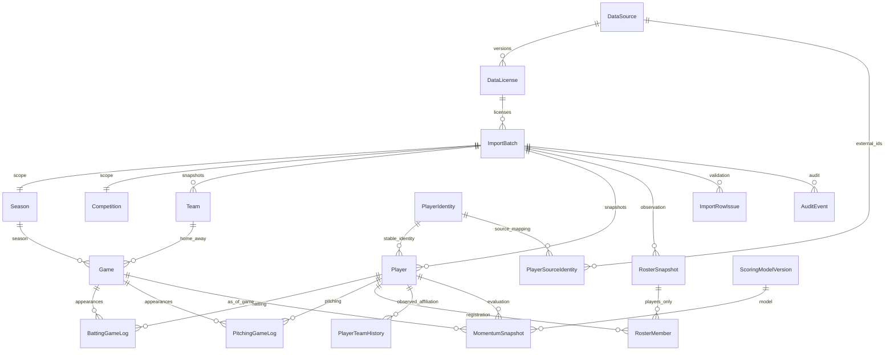

# PostgreSQL 스키마 초안

2026-11-03. **실행 검증 대기**. DATA_DICTIONARY v1의 배치 스냅샷을 기준으로 한다. 외부 데이터·모델·운영 연결은 없다. Prisma 의존성 설치는 자동 승인 검토가 P0 설치 금지 규칙을 근거로 거절했다. Docker/psql도 현재 PATH 및 일반 설치 경로에서 확인되지 않았다. migrate/generate/smoke 완료를 주장하지 않는다.

## 식별·키

- PlayerIdentity는 전역 사람 ID다. Player는 `(batch_id, player_id)` 버전이다. display_name은 중복 가능하며 이름으로 병합하지 않는다. PlayerSourceIdentity의 `(source_id, external_player_id)`는 검증 감사 이벤트와 연결한다.
- Team/Player/Season/Competition/Game/등록/소속/점수는 출처·권리·배치·as_of·source_record_key·missing_fields를 보존한다. 모든 배치 데이터 관계는 composite FK로 배치 경계를 지킨다.
- Game은 시즌·대회 REGULAR/POSTSEASON, 최초 날짜/실제 날짜, 홈·원정, DH 0/1/2, 상태, revision, 정정 시각·직전 배치를 가진다. scheduled_at_kst는 nullable timestamptz다. KST offset 입력을 절대시각으로 저장하고 Asia/Seoul로 표시한다. 미상 시간을 자정으로 채우지 않는다.
- 각 경기 로그 PK는 `(batch_id, game_id, player_id)`다. 외부 게임·선수·출전 ID와 role의 배치별 unique를 함께 둔다. 재개 누적은 같은 경기 한 행, DH는 별개 경기 ID다. 배치 간 같은 출전은 정정 보존 때문에 허용하며 canonical_hash unique로 동일 전체 배치 중복을 거부한다.
- MomentumSnapshot은 사전의 cutoff/team_scope 키와 요청한 시즌·대회·선수·role·window·as_of_game·모델 키를 배치 내에서 모두 검사한다. 배치 없는 전역 unique는 과거 정정본을 파괴하므로 사용하지 않는다. 모델 미채택 상태에서는 점수 생성 금지이며 이 생성 서비스는 아직 없다.
- RosterSnapshot은 날짜별 헤더, RosterMember는 날짜·선수별 상태다. 감독·코치 엔티티나 roster 회원 종류를 제공하지 않는다. 소속 이력은 관측 사실이며 날짜 사이 연속 소속을 추정하지 않는다.

## DB 제약과 삭제 정책

첫 SQL은 enum, 범위·음수·부분합·TB·GS/role·권리기간·해시 CHECK, 복합 FK, 인덱스를 포함한다. 투구는 outs_recorded Int?이며 IP 십진 필드는 없다. 미제공 카운트에는 기본값 0이 없다. 이름 정렬 및 lower 이름 prefix 검색, 경기 날짜, 시즌·role·window·점수 ranking, 선수별 로그 인덱스를 둔다. substring 검색용 trigram 확장은 아직 도입하지 않았다.

FK 삭제·ID 갱신은 모두 RESTRICT다. 라이선스·완전 배치·버전 행·감사는 update/delete trigger로 불변 보존한다. 배치 상태는 DB 삽입 전 검증해 확정하고 이후 전이는 AuditEvent에 추가한다. 순환 scope FK는 SQL에서 deferred이므로 배치와 시즌·대회는 한 트랜잭션으로 넣는다. Prisma schema는 CHECK/trigger/deferrability를 표현하지 못하므로 migration SQL이 필수이며 `db push`로 대체하지 않는다.

DataSource.current_status는 현재 권리 차단 상태다. 과거 DataLicense는 불변이다. 수입·조회·게시에서 최신 권리, 만료, scope, 필드 allowlist를 재검사하는 서비스는 후속 구현 대상이며 스키마만으로 APPROVED 공개를 허용하지 않는다.

## 실행

Prisma 7 구성은 [공식 v7 문서](https://docs.prisma.io/docs/guides/upgrade-prisma-orm/v7)를 참조했다. 설치 승인 후 ADR-008의 안정 버전 7.10.1 가용성을 레지스트리에서 다시 확인하고 prisma(개발), @prisma/client, @prisma/adapter-pg, pg(런타임), @types/pg(개발)를 exact 버전·lockfile로 설치해야 한다. 현재 package.json에는 미설치 패키지를 추가하지 않았다.

1. Docker Desktop 등 Docker Compose 실행 환경을 준비한다.
2. `.env.example`의 빈 항목을 참고해 셸에 POSTGRES_USER/POSTGRES_PASSWORD를 설정한다. 비밀은 커밋하지 않는다. 개발 URL은 `postgresql://<user>:<encoded-password>@127.0.0.1:5432/dugout_pulse` 형태다.
3. `pnpm db:up`으로 개발 DB를 실행한다. `DATABASE_URL`을 셸에 export한다. 설정은 `.env`를 자동 로딩하지 않는다.
4. `pnpm db:validate`, `pnpm db:generate`, `pnpm db:migrate`, `pnpm db:smoke`를 실행한다.
5. 운영은 Compose를 배포하지 않고 관리형 PostgreSQL의 DATABASE_URL을 비밀 주입한다. 공급자의 인증서 검증/TLS 설정을 유지하며 TLS 검증을 끄지 않는다. migration에는 DDL 권한 계정, 앱에는 최소권한 계정을 사용한다.

smoke는 실제 연결·Prisma 쓰기/읽기·rollback을 검사한다. UI에 DB 데이터를 연결하지 않았으므로 화면 확인 대상은 없고 기존 페이지는 그대로다. 개발 DB는 `pnpm db:down`으로 멈추며 볼륨은 보존된다.

## 검증 기록·남은 수락 기준

- `pnpm db:generate`: 실패, prisma command not found.
- `pnpm db:migrate`: 실패, prisma command not found.
- `pnpm db:smoke`: 실패, @prisma/adapter-pg 미설치.
- SQL은 실행 전 초안이다. 실제 PostgreSQL 적용, Prisma validate 및 introspection drift 비교, 음수/교차 배치/DH/중복/동명이인/rollback fixture 통합 테스트가 남았다.
- missing_fields와 NULL의 일대일 대응, NFC·공백·배열 고유값, 시즌 날짜 범위, roster 기준일, 경기 팀과 로그 팀 일치, cancelled 출전 금지, 외부 매핑과 출전 ID 일치, 채택 모델의 role별 JSON 구조·입력 참조·표본·cutoff 검증은 아직 입력 서비스 및 DB 통합 테스트로 완성해야 한다. 현재 스키마를 P2 전체 계약 검증 완료로 취급하지 않는다.
- SCHEMA/ADR 초안 작성은 DB 테스트 통과가 아니다. 위 기준을 충족하기 전 다음 단계로 진행하지 않는다.

추가 실행 결과: `pnpm test` 2개 통과, `pnpm lint` 통과, `node --check scripts/db-smoke.mjs` 통과. `pnpm typecheck`는 미설치 `prisma/config` 모듈 때문에 실패했다. Prettier는 TS/YAML/JS/JSON을 처리했으나 Prisma와 .env 파서는 없어 해당 두 파일 형식 검사는 실패했다. 기존 단위 테스트 통과는 DB 검증을 뜻하지 않는다.

### DEMO MomentumSnapshot 실행 저장소 마이그레이션 (ADR-017)

Prisma 참조 스키마와 별개로 현재 실행 경로는 파일 저장소다. PipelineState v1에 선택 필드 `momentumSnapshots: Record<sha256, MomentumSnapshot>`과 `momentumCurrent: string[]`을 추가했다. 원본 기록·이력·기존 scores를 파괴하지 않는 additive migration이다. 기존 저장소는 다음 변경 게시, 이미 게시된 배치 재게시 또는 서버 내부 `recalculateMomentum()` 트랜잭션에서 초기화된다. GET은 파일을 변경하지 않는다. 초기화 전 GET은 빈 배열을 반환한다.

스냅샷 계약은 `src/contracts/momentum.ts`, 실행 타입은 `src/server/reads/momentum.ts`다. modelVersion/algorithmVersion, computedAt, asOf, dataAsOfGameId, window/windowBasis, role, season/competition, rawFeatureSummary, score, confidence, eligibility, explanation, deltaScore/previousSnapshotId, sourceIds/inputRefs, sampleSize, demo, publicationRevision, rankingStatus를 보존한다. score는 반올림 전 수치이며 화면에서 반올림한다. 미산출도 스냅샷으로 보존하며 dataAsOfGameId/score/confidence는 null일 수 있다.
